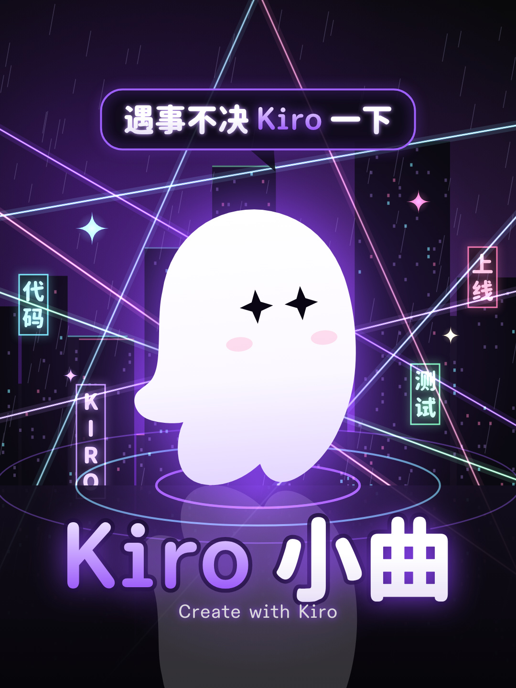

# Kiro 小曲

一首写给 Kiro 的迪斯科放克小曲和它的 MV：一个程序员从凌晨两点的灵感，到周五晚上准时下班进舞池。

成片（微信视频号）：https://weixin.qq.com/sph/Af1XoDyJm8



整首歌和 MV 都是 Kiro（AI agent）在对话里做的，包括写词、定曲风、生成歌曲、剪辑、歌词定时、写画面代码、渲染、检查和做封面。人负责定方向、挑歌、提意见。这个仓库只放最终版的源文件，下面写的是做法。

## 目录

| 路径 | 内容 |
|---|---|
| `song/lyrics.txt` | 歌词（带段落标记） |
| `song/kiro_xiaoqu.flac` | 最终母带，24 bit / 48 kHz |
| `mv/index.html` 和 `mv/*.js` | MV 页面：1080×1920、60 fps，每一帧都由代码画出 |
| `mv/cues.json` | 歌词逐字时间，以及速度和第一拍的位置 |
| `mv/ghost_geom.json` | 小鬼头的官方轮廓，取自 kiro.dev/icon.svg |
| `mv/cover.html`、`mv/cover.js` | 封面页（3:4、16:9、9:16） |
| `tools/render.mjs` | 逐帧渲染器：无头浏览器、多进程、边画边编码 |
| `tools/fetch_fonts.sh` | 下载页面用到的字体 |
| `outputs.json` | 整片的编码设置 |

## 怎么做出来的

### 1. 选题：圈内人一听就懂的场景，加一个钩子

- 写开发者自己的一天：凌晨两点有灵感，老板催进度、产品改需求，测试红了，线上挂了，最后准时下班。听的人会觉得「这就是我」。
- 钩子先定下来：「遇事不决 Kiro 一下」。产品名本身就是钩子，副歌里重复四次。

### 2. 写词：有韵脚、有节拍，写真实的功能

- 每段一个韵（a、ai、ao），每句是 4+4 字的对仗短句。这样唱出来有节拍，不像念旁白。
- 主歌一句写一个真实功能，都写成动作：
  - Spec：「需求它写 设计它画 / 任务它排 我来喝茶」
  - Hooks：「文件一存 测试就跑」
  - Steering：「规矩一条 它都记牢」
  - 桥段写 vibe 和 spec 两种工作方式：「想 vibe 就 vibe 随便嗨 / 要 spec 就 spec 有安排」。
- 三遍副歌的框架不变，只换第二句的关键词，所以每遍意思往前走一步：
  - 「一句想法 变成计划」
  - 「红灯变绿 bug 全拿下」
  - 「周五晚上 不加班啦」
- 最后一句把「准时下班 回家啦」翻成「今晚舞池 我来啦」。
- 歌不从喊钩子开始，开头喊不好听。先用两小节乐队前奏，再进主歌。

### 3. 作曲：词曲一起设计，生成整首，用耳朵挑

- 曲风从词的情绪推出来。词轻快、有点得意，配迪斯科放克（nu-disco funk pop）：
  - 约 117 BPM，小调七和弦循环；
  - 每拍一下底鼓，军鼓在二、四拍，十六分音符的踩镲；
  - 女声，咬字清楚，用旋律化的节奏型唱，不说唱。
- 用音乐生成模型直接生成整首歌，人声和编曲一起出，不生成片段再拼。
- 每种写法（不同的风格描述）只出一版，一轮几首，直接听。不按自动转写的错字率挑，转写本身也有误差。
- 选中的一版只做最小的剪辑：
  - 去掉开头的喊唱，用人声分离得到的纯伴奏补两小节前奏；
  - 在小节线上交叉淡化，接回原曲；
  - 母带只调增益，不做重压缩。

### 4. 歌词逐字定时

1. 用人声分离只留下人声。
2. 按低能量点把人声切成二十几秒的段，逐段做语音识别和强制对齐，得到每个字的时间。整首一次对齐容易失步。
3. 按拼音把识别结果对回歌词，再把每个字吸附到最近的人声起音上。
4. 人工核对容易错的地方：
   - 长拖音句的句尾字，对齐常把它放到后面的和声或气声上。这首歌里「灵感来啦」的「啦」和「设计它画」的「画」就是对着人声起音改回来的。
   - 副歌里挤成一团的几句。
5. 结果写进 `mv/cues.json`，画面上所有和歌词有关的动作都从这里取时间。

### 5. 画面设计

- **一个贯穿全片的概念**：程序员的一夜，全部发生在一座下雨的赛博朋克夜城里，界面元素就是舞台道具。歌往前走一段，城里就多一点派对的样子。
- **主角**：官方 logo 的小鬼头，形状和颜色都不改。它每拍都在跳，有 14 种表情，按情节换：睡、惊、星星眼、爱心眼、大笑、眨眼、晕、生气、哭、半睁等。
- **符号**：全片只用这些：
  - HUD 时钟：02:00 → 18:00 → FRI 18:00
  - 灯泡（灵感）
  - spec 的三个文件、测试灯、Agent Hook、steering 文件、Kiro CLI 终端
  - Kiro Crew
  - 全息核心、激光、湿街面
- **Kiro 的真实元素**：
  - IDE：
    - 聊天里的 Vibe / Spec 模式
    - `.kiro/specs/<feature>/` 下的 requirements、design、tasks，tasks 上的 Start task
    - Agent Hook「On File Save → 运行测试」
    - `.kiro/steering/` 里 `inclusion: always` 的规矩
  - CLI：线上故障时，`kiro-cli chat` 读日志、定位、修复、跑测试、提 PR。
  - Crew：
    - 桥段分身出来的五只小鬼头就是 Kiro Crew，各带角色标签，连成一张图；
    - 最后一遍副歌整群都是 crew，配官网那句 keeps working while you're away。
  - 片尾 Kiro IDE、CLI、Crew 三个标签汇进 icon。
- **逐段加码**：三遍副歌一遍比一遍满。
  - 第一遍：四道激光，街面每拍一圈光环。
  - 第二遍：全息核心降下，加一把激光扇，小鬼头带残影。
  - 第三遍：整群 crew，全部连线，满屏彩纸。
  - 主歌和桥段比副歌空，留出落差。
- **镜头不硬切**：上一个镜头最后的焦点，推进成下一个镜头的开头。
  - 终端光标 → 时钟
  - 灯泡 → 聊天框
  - 三个文件 → 三张 spec 卡
  - 隧道尽头 → 舞池
  - 街面上的一道光 → 测试面板
  - 告警红点 → 监控图
  - 全息核心 → 桥段
  - 五只小鬼头 → 第三遍副歌的前排
  - 舞池的光旋进中心 → icon
- **字幕是画面的一部分**：
  - 每个字唱到才出现；
  - 位置跟着画面走：聊天气泡里、卡片上方、测试面板旁、上下两半屏里；
  - 28 句各有自己的入场：终端输入、行内补全被 Tab 接受、键帽按下、描线、全息、切片错位、立体挤出、HUD 锁定、激光扫出、故障、扫色、随波浪、吸附网格、翻转、弹跳等；
  - 关键词单独上色。
- **品牌规范**：
  - 字体按 kiro.dev 的设计 token：标题用 display 字体，界面用正文字体，代码用代码字体。
  - 中文用圆体黑体，和 display 字体的圆角搭；终端里的中文用编程字体。
  - 颜色用官网的紫色阶和深灰底，霓虹色直接用官网代码高亮那几种颜色。
- **节奏**：
  - 动作都挂在节拍上：底鼓一拍一次的光在一帧半里亮起、约 0.3 秒里退下，军鼓落在二、四拍，大动作在小节线上。
  - 冲击用光表现，不闪白、不震屏。
  - 灯光起伏都有起音和衰减，避免频闪。

### 6. 用代码画

- 整片是一个 1080×1920 的 Canvas 2D 页面。每一帧只由时间 t 决定：不用随机数、系统时钟和 requestAnimationFrame。所以可以多进程逐帧渲染，结果每次都一样。
- 页面约定：
  - `window.DEMO` 给出尺寸、帧率、时长；
  - `window.renderAt(t)` 画出 t 时刻那一帧；
  - `window.__ready` 表示可以开始。
  - 加 `?lyrics=1` 只画歌词（白字黑底），给检查用。
- 运动模糊和光：
  - 换镜头时两个镜头分别画进缓冲，在半帧快门内取多个子时刻求平均，做出运动模糊；
  - 镜头平移按位移做拖影；
  - 高光在四分之一分辨率上取亮部、模糊后叠回去，做出泛光。
- 渲染：无头浏览器逐帧调用 `renderAt`，读画布像素，多个进程边画边编码，最后接上音轨。

### 7. 检查

- 音画同步、尺寸和帧率。
- 用只画字的版本检查两件事：每句停住时都在短视频平台的安全区里（x 60–940、y 220–1440）；每个字都在唱到时才亮起。
- 闪烁每秒不超过 3 次（本片最多 2 次）；数一遍突变帧，确认没有硬切和白闪。
- 封面缩到信息流的大小，分别放在白底和黑底上看：主体和标题是否一眼认得出。

### 8. 封面

一个主体：星星眼的小鬼头站在光环上。一个反差：头顶气泡里的钩子「遇事不决 Kiro 一下」。一个大标题「Kiro 小曲」，再加一行小字。共出三种比例：

- 3:4：底部留出平台叠信息的位置，不放字；
- 16:9：重要元素都放在中间，裁中间就是 4:3；
- 9:16：竖屏视频封面。

## 自己渲染

需要 Node 18+、ffmpeg 和 Chrome（或 Chromium）。

```bash
bash tools/fetch_fonts.sh                 # 需要 curl、unzip，以及 7z 或 Python 的 py7zr
npm install --prefix tools
export MG_CHROME=/path/to/chrome          # Linux 上通常还要 MG_GPU_ARGS=--no-sandbox；TMPDIR 用短路径

node tools/render.mjs mv --stills 30,74.6 --scale 1                                   # 抽帧 → mv/out/stills/
node tools/render.mjs mv --capture canvas --outputs outputs.json \
  --audio song/kiro_xiaoqu.flac --workers 12                                          # 整片 → out/kiro_xiaoqu_mv.mp4
node tools/render.mjs mv --page cover.html --query fmt=34 --stills 0 --scale 2        # 封面；fmt=34 / 169 / 916
```

## 相关项目

- [oh-my-bgm](https://github.com/maxlumo/oh-my-bgm)：用代码写背景音乐的 agent skill，用 Python 作曲、演奏、混音并自检器乐。

## 授权

- Kiro 的名称和小鬼头标志属于 Kiro（AWS）。轮廓取自 kiro.dev/icon.svg，没有改形状和颜色。
- 字体：
  - AWS Diatype 系列是 Dinamo 授权给 AWS 的商业字体，仓库里不附带。`fetch_fonts.sh` 从 kiro.dev 下载，你的用途需要在它的授权范围内。
  - Fragment Mono、Resource Han Rounded、Maple Mono CN、Noto Sans SC 都是 SIL OFL 1.1，授权文本在 `mv/fonts/`。
- `tools/render.mjs` 来自 mg-styles-15，MIT 许可，见 `tools/LICENSE-render.txt`。
